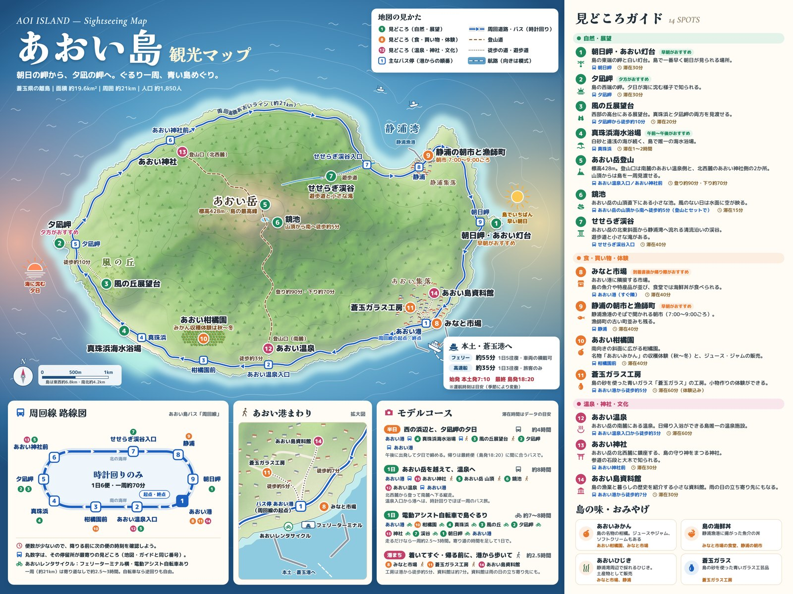

# あおい島 観光マップ

架空の離島「あおい島」の観光マップです。支給された島データ（`aoi-island-data.md`）の地名・場所・路線を正しいものとして描きました。



## ファイル

| ファイル | 内容 |
|---|---|
| **`aoi-island-map.svg`** | **本体。1枚で完結する観光マップ（約1.1MB）。** フォントと地形の絵も中に埋め込んでいるので、このファイルだけで表示できます。ブラウザで開くと、画面に合わせて全体が表示されます |
| `aoi-island-map.png` | SVG を画像にしたもの（4800×3600px）。細かい文字は拡大して見られます |
| `aoi-island-map_print.pdf` | 印刷用のPDF（420×315mm・1ページ。A3横に近い大きさ） |
| `docs/preview.jpg` | 縮小プレビュー（1600×1200px） |
| `build/validation.txt` | 島データと地図の中身を機械的に照合した結果（83項目すべてOK） |
| `src/` | 生成スクリプト一式（島データ → 地形・道路・停留所の座標 → SVG → 照合 → PNG） |
| `fonts/` | 埋め込んだフォントのライセンス（すべて SIL Open Font License 1.1） |
| `_backup_orphan-run-0838/` | 作業フォルダに残っていた、ハーネス管理外の前回実行（08:38開始）の成果物。消さずに退避したもの（RUN.md 参照） |

## マップの構成

- **地図（左の大きな面）**
  - 地形：あおい岳（428m、中央やや北寄り）を最高点とする標高モデルの段彩と陰影、等高線（50mごと）、真珠浜の白砂と遠浅の海、風の丘の草原、南向き斜面の柑橘園
  - **見どころ14か所**：データの番号（1〜14）を、3つの区分の色（緑＝自然・展望、オレンジ＝食・買い物・体験、赤紫＝温泉・神社・文化）の丸で表示。早朝・夕方が見頃の場所、朝市の時間（7:00〜9:00ごろ）、収穫体験の時期（秋〜冬）は地図にも書き添えました
  - **周回線バス**：周回道路（あおいライン）の上に青い線と進行方向の矢印を描き、「あおい港から時計回り」がひと目でわかるようにしました。停留所は四角に「あおい港からの順番（1〜9）」を入れています
  - 登山道2本（南麓のあおい温泉側、北西麓のあおい神社側）と所要時間、徒歩の道（風の丘展望台へ約10分、あおい温泉へ約3分 など）、せせらぎ渓谷の遊歩道
  - 本土・蒼玉港への航路と、フェリー・高速船の所要時間・便数・始発/最終
  - 東の海に「島でいちばん早い朝日」、西の海に「海に沈む夕日」のしるし
- **周回線 路線図**：角丸の輪を島に見立て、停留所を島での方角どおりに配置（港＝南東、真珠浜＝南西、夕凪岬＝西、神社前＝北西、渓谷入口と静浦＝北東、朝日岬＝東）。各停留所が最寄りの見どころの番号も添えています
- **あおい港まわり 拡大図**：フェリーターミナル、バス停（起点）、みなと市場、あおいレンタサイクル、蒼玉ガラス工房（徒歩約5分）、あおい島資料館（徒歩約7分）
- **モデルコース4本**：半日のバス旅、あおい岳縦走と温泉（1日）、電動アシスト自転車で一周（1日）、港から歩ける3か所。区間ごとに移動手段（バス・徒歩・自転車）のアイコンを付けました
- **見どころガイド（右の列）**：14か所の説明（データの文章のまま）、最寄りバス停と徒歩時間、滞在の目安、おすすめの時間帯
- **島の味・おみやげ**：あおいみかん、島の海鮮丼、あおいひじき、蒼玉ガラス

## データどおりに描くための工夫

- 地名・数値・説明文は `src/island_data.py`（データを構造化したもの）からだけ差し込み、手で打ち直していません。データにない施設名や時刻は書いていません（家・木・漁船などは名前のない飾りとしてだけ描いています）。
- 位置関係は `src/validate.py` で機械的に確かめています（結果は `build/validation.txt`）。主な項目：
  - 島の外接寸法 6.80km × 4.20km、面積 19.58km²（データは約19.6km²）、周囲 21.06km（データは約21km）。縮尺バーはこの寸法から作っています
  - 停留所が、あおい港から時計回りにデータの順番（1〜9）で並ぶこと／バスの進行方向が時計回りであること／朝日岬から港へは東海岸を南下すること
  - 各停留所・見どころ・地形が、データの方角（南東部・北西部・東端など）にあること
  - 鏡池が山頂の南（登山道で約250m＝徒歩約5分）、温泉が山の南麓、神社が北西麓、渓谷が北東斜面から静浦湾へ注ぐこと
  - せせらぎ渓谷入口が、道路が渓流を渡る地点にあること
  - 各見どころに一番近い停留所が、データの「最寄り停留所」と一致すること
  - 徒歩3・5・7・10分の道のりが、分速80mの目安と合うこと
  - 標高モデルの最高点が山頂で、ちょうど428mになること
  - データの地名・施設名・特産品・数値がすべて地図に書かれていること、地図のラベルどうしが重ならないこと
- モデルコースの所要時間は、データの滞在目安・登山時間・バスの一周時間などから見積もりました。バスの時刻表はデータにないため、待ち時間は含めていません（路線図に「降りる前に次の便の時刻を確認」と注意書きを入れています）。

### データと一致していない点・推測で描いた点

- **周回道路の長さ**：地図上の道路は縮尺で測ると約16.9kmです（データは全長約21km）。海岸の細かな出入りまでたどると線が細かく波打って見づらくなるため、道路はなめらかにして描きました。文字ではデータどおり「約21km」と書いています。
- **航路の向き**：データに本土の方角がないため、港が開いている南東へ模式的に描きました。凡例に「向きは模式」と書いています。
- **港まわりの細かな配置**（市場・工房・資料館・レンタサイクルが港のどちら側にあるか）、**滝の位置**、**登山道の道筋**は、データの「すぐ隣」「徒歩約5分」「遊歩道と小さな滝がある」などの記述に合うように置いたもので、方角まではデータに書かれていません。
- 路線図の停留所の間隔は模式的です（実際の道のりの比率ではありません）。
- 「自転車なら逆回りも自由」は、バスの時計回りの制約が自転車にはかからない、という推測による案内です。

## 作り直し方

```bash
python3 -m venv /tmp/aoi-venv && /tmp/aoi-venv/bin/pip install -r src/requirements.txt
# フォント（下記の TTF）を1つのフォルダに置き、AOI_FONT_DIR で指定する
AOI_FONT_DIR=/path/to/fonts /tmp/aoi-venv/bin/python src/build.py
```

`build.py` は SVG を作り、照合レポートを書き出し、Google Chrome（ヘッドレス）で PNG を書き出します。印刷用 PDF は、SVG を 420×315mm のページに貼った HTML を Chrome で PDF にしたものです。

## フォント

使う文字だけに絞って SVG に埋め込んでいます（別名 AoiRounded / AoiTitle / AoiFeature / AoiLatin）。

- M PLUS Rounded 1c（Medium・Bold・ExtraBold）：本文とラベル
- Kaisei Tokumin ExtraBold：タイトルと見出し
- Kaisei Decol Bold：山・湾・丘などの地形名
- Cormorant Garamond Italic：欧文の飾り

いずれも SIL Open Font License 1.1 です（`fonts/` にライセンス文）。
