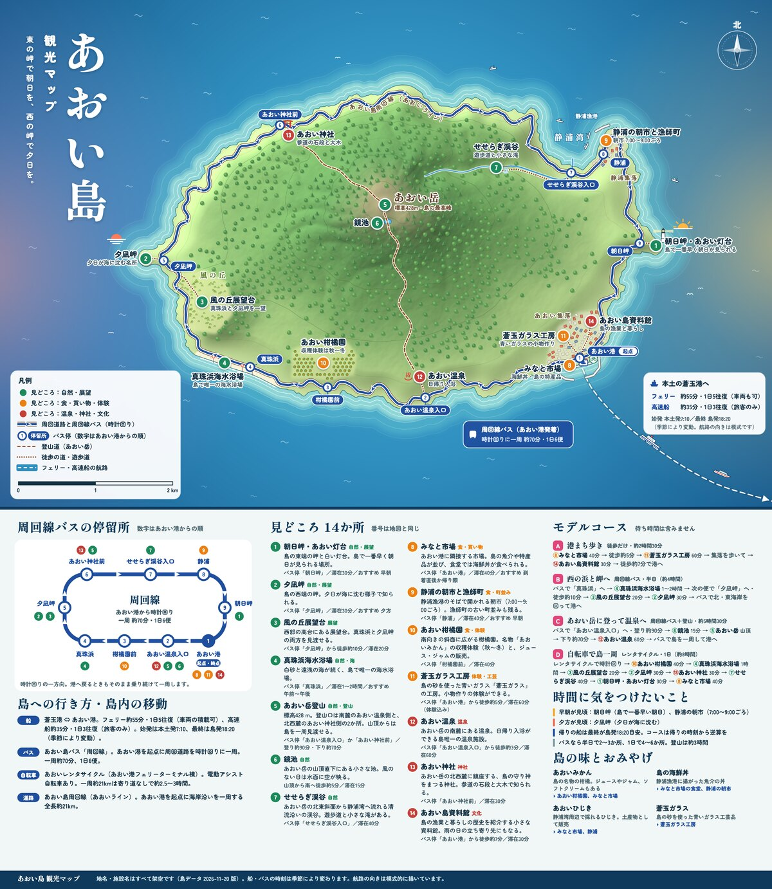

# あおい島 観光マップ

架空の離島「あおい島」の観光マップです。支給された島データ（`aoi-island-data.md`）の地名・位置・路線を正として描いています。



## ファイル

| ファイル | 内容 |
|---|---|
| **`aoi-island-map.svg`** | **メインの成果物。** 1枚で完結する観光マップ（上：地図、下：ガイド欄）。フォント・地形画像も埋め込んだ単一ファイルです。ブラウザで開いてください |
| `index.html` | 操作できるWeb版。地図の拡大・移動、スポットの詳細、種類での絞り込み、モデルコースの地図表示、周回線の路線図。1ファイルで動きます |
| `aoi-island-map.png` | SVGを画像にしたもの（3200×3684px） |
| `aoi-island-map_A3.pdf` | 印刷用。A3横・2ページ（表：地図、裏：ガイド） |
| `docs/` | Web版のスクリーンショット |
| `build/validation.txt` | 島データと地図の座標を機械的に照合した結果（全項目OK） |
| `src/` | 生成スクリプト一式（島データ → 座標 → 地形 → SVG / HTML / PDF） |
| `fonts/` | 埋め込んだフォントのライセンス（SIL Open Font License 1.1） |

## 地図に入れたもの

- **見どころ14か所**：データの番号（1〜14）と分類（自然・展望／食・買い物・体験／温泉・神社・文化）を、番号と色で示しています。早朝・夕方が見頃のスポットや朝市の時間（7:00〜9:00ごろ）は、地図上にも書き添えました。
- **周回線バス**：あおい港を起点に、周回道路（あおいライン）を時計回りに一周する路線です。道路の上に向きの矢印を描き、停留所の丸には「あおい港からの順番（1〜9）」を入れました。
- **登山道と徒歩の道**：あおい岳の登山口は2か所で、南麓のあおい温泉側と北西麓のあおい神社側です（登り約90分・下り約70分）。鏡池は山頂の南（徒歩約5分）に置きました。ほかに、夕凪岬バス停から風の丘展望台までの道（徒歩約10分）、渓谷の遊歩道、港から工房（約5分）と資料館（約7分）への道も描いています。
- **航路**：本土の蒼玉港 ⇔ あおい港。フェリーは約55分・1日5往復（車両の積載可）、高速船は約35分・1日3往復（旅客のみ）。始発は本土発7:10、最終は島発18:20です。
- **地形**：中央やや北寄りのあおい岳（428m・島の最高峰）、静浦湾、せせらぎ渓谷（北東斜面から静浦湾へ）、風の丘（真珠浜と夕凪岬の間の高台）、真珠浜の白砂。
- **ガイド欄（SVG下段／Web版の各章）**：島の形に合わせて並べた周回線の路線図、見どころの説明・最寄りバス停・滞在の目安、モデルコース4本、時間に気をつけたいこと、島の味とおみやげ。
- **あおい港のまわりの拡大図**（Web版・印刷版）：フェリーターミナル、バス停、レンタサイクル、市場・工房・資料館の位置と徒歩時間。

## データに忠実にするための工夫

- 地名・数値・説明文は、すべて `src/aoi_data.py`（データを構造化したもの）から差し込んでいます。データにない施設名は書いていません。木・家・波・船などは、名前を付けない飾りとしてだけ描いています。
- 位置関係は `src/geo.py` の `validate()` で機械的に確かめています（結果は `build/validation.txt`）。
  - 島の外接寸法：東西6.80km × 南北4.20km。面積19.7km²（データは約19.6km²）、海岸線21.0km（データは約21km）。縮尺バーはこの寸法から作っています。
  - 道路が時計回りであること。停留所が「あおい港 → あおい温泉入口 → 柑橘園前 → 真珠浜 → 夕凪岬 → あおい神社前 → せせらぎ渓谷入口 → 静浦 → 朝日岬」の順に並ぶこと。
  - 各停留所・スポットが、データにある島の方角（南東部・北西部など）にあること。
  - 鏡池が山頂の南にあること。温泉が山の南麓、神社が北西麓にあること。渓谷が北東斜面から静浦湾に注いでいること。
  - 各スポットの最寄りバス停がデータと一致すること。徒歩時間（3・5・7・10分）と道のりが合うこと。
  - 標高モデルの最高点が山頂で、ちょうど428mになること。
- モデルコースの所要時間は、データの滞在目安と移動時間を足して出しています。バスの時刻表はデータにないため、乗り継ぎの待ち時間は含めておらず、その旨を明記しています。周回線は時計回りだけなので、港へ戻るときは乗り続けて一周する前提で計算しています。

### データと一致していない点・推測で描いた点

- **周回道路の長さ**：地図に描いた道路は約19.2kmで、データ（約21km）より1割ほど短くなっています。地図の縮尺に合わせて、海岸の細かい曲がりを省いて描いたためです。文章ではデータの「約21km」をそのまま書いています。
- **本土への航路の向き**：データに本土の方角がないため、港が開いている南東へ模式的に描きました。地図上にも「航路の向きは模式」と書いています。
- バス停と施設の細かな位置関係（市場が港のどちら側にあるか、など）は、データの「すぐ隣」「徒歩約5分」などの記述に合うように置いたもので、データには書かれていません。

## Web版（index.html）の操作

- 地図の番号を押すと詳細が出て、その場所へ寄ります（キーボードでは Tab で選んで Enter）。
- ＋／－／全体のボタン、ドラッグ、ピンチ、Ctrl（Mac は ⌘）＋スクロールで拡大・移動できます。
- 「地図に出す見どころ」で種類を絞り込み、スイッチでバス路線や登山道の表示を切り替えられます。
- 路線図の停留所や、見どころ一覧の「地図で見る」を押すと、地図のその場所へ移動します。
- モデルコースの「地図でコースを見る」で、経路と回る順番を地図に重ねて表示します。
- スマホでは、路線図が縦の一覧になり、詳細は画面の下から出ます。

## 作り直し方

```bash
python3 -m venv /tmp/aoi-venv && /tmp/aoi-venv/bin/pip install -r src/requirements.txt
# フォント（Zen Maru Gothic の Medium/Bold/Black、Shippori Mincho B1 の ExtraBold）を /tmp/aoi-fonts に置く
/tmp/aoi-venv/bin/python src/build.py      # index.html / aoi-island-map.svg / PNG / PDF を生成
```

PNGとPDFの書き出しには Google Chrome（ヘッドレス）を使います。`src/preview.py` は地図だけを描いて確認するための補助スクリプト、`src/debug_plot.py` は座標の確認用です。

## フォント

Zen Maru Gothic と Shippori Mincho B1（どちらも SIL Open Font License 1.1）を、使う文字だけに絞って別名（AoiMaru / AoiMincho）で埋め込んでいます。ライセンス文は `fonts/` にあります。
