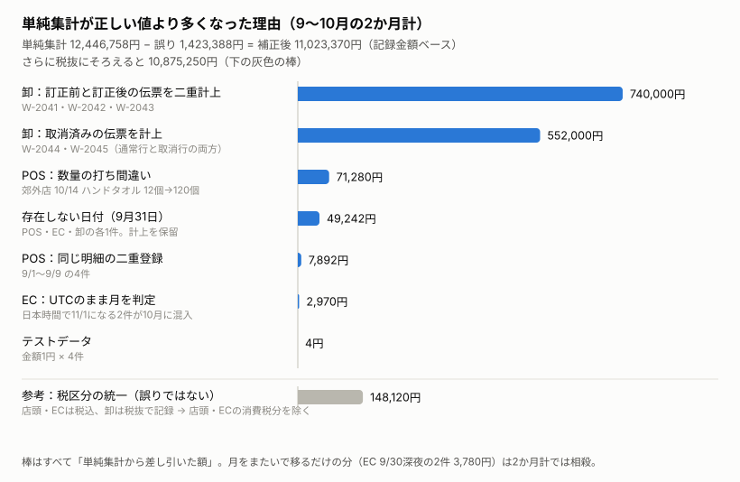
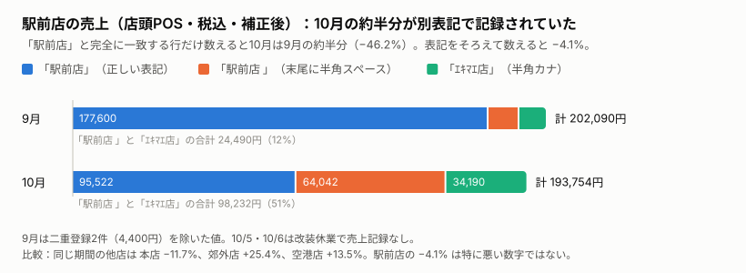

# 9〜10月 売上不整合の調査報告

- 作成日：2026年11月20日
- 宛先：経営企画室（11/4付「9〜10月売上の不整合の調査について」への回答）
- 突き合わせたデータ：`pos.csv`（店頭POS）、`ec_orders.xlsx`（EC注文）、`wholesale.csv`（卸売伝票）、`mail.txt`（店舗・経営企画室からのメール4通）
- 金額の単位：すべて円

---

## 1. 結論

1. **正しい月次売上（税抜・全チャネル合計）は、9月 5,169,100円、10月 5,706,150円**です（2か月計 10,875,250円）。税込にそろえた場合は9月 5,661,600円、10月 6,247,130円です。
2. 支給データをそのまま足した「単純集計」は9月 6,206,058円、10月 6,240,700円で、正しい値より2か月で **1,423,388円多く** なっていました（記録金額のまま比べた場合）。この差は7種類のデータ処理の誤りで、1円単位まで説明できます。**差の約91%（1,292,000円）は、卸売の訂正伝票と取消伝票の二重計上**です。
3. これとは別に、店頭・ECの金額は税込、卸売の金額は税抜で記録されており、そのまま足すと税込と税抜が混ざります。税抜にそろえると、さらに148,120円下がります。
4. **「駅前店の改装休業による不振が主因」という仮説は、データでは支持されません。**
   - 10月の全社売上は減っておらず、9月より **10.4%増えて** います（税抜）。
   - 駅前店の減少は9月比−4.1%（−8,336円）にとどまり、休業2日分として見込まれる減少（約13,500円）より小さい額です。減少率は本店（−11.7%）のほうが大きくなっています。
   - 駅前店が「半減した」ように見えるのは、10月の駅前店の売上の51%が「駅前店 」（末尾に空白）や「ｴｷﾏｴ店」（半角カナ）という別の表記で記録されていたためです。
   - 差の1,423,388円のうち、駅前店に関わる補正は二重登録2件の4,400円（0.3%）だけです。
5. 日付が「9月31日」という存在しない日になっている3件は、計上月を確定できないため保留とし、上の数字には含めていません。9月分と確認できれば、9月が税抜で48,900円増えます。

### 正しい月次売上（まとめ）

| | 9月 | 10月 | 2か月計 |
|---|---:|---:|---:|
| 単純集計（補正前：記録金額をそのまま合算） | 6,206,058 | 6,240,700 | 12,446,758 |
| 補正後（記録金額のまま：店頭・EC＝税込、卸＝税抜） | 5,241,140 | 5,782,230 | 11,023,370 |
| **補正後・税抜にそろえた値＝正しい売上高** | **5,169,100** | **5,706,150** | **10,875,250** |
| 参考：補正後・税込にそろえた値 | 5,661,600 | 6,247,130 | 11,908,730 |
| 保留（9月31日付の3件。上の行には含めていない） | 税抜 48,900 | — | 税抜 48,900 |

---

## 2. 正しい数字の内訳

### 2-1. チャネル別（税抜）

| チャネル | 9月 | 10月 | 前月比 |
|---|---:|---:|---:|
| 店頭（POS・4店舗） | 625,500 | 648,250 | +3.6% |
| EC | 138,600 | 142,400 | +2.7% |
| 卸売 | 4,405,000 | 4,915,500 | +11.6% |
| **合計** | **5,169,100** | **5,706,150** | **+10.4%** |

### 2-2. チャネル別の補正前と補正後

| チャネル | 9月 単純集計 | 9月 補正後（記録金額） | 10月 単純集計 | 10月 補正後（記録金額） | 記録の税区分 |
|---|---:|---:|---:|---:|---|
| 店頭（POS） | 694,935 | 684,450 | 781,954 | 710,674 | 税込 |
| EC | 157,122 | 151,690 | 155,246 | 156,056 | 税込 |
| 卸売 | 5,354,001 | 4,405,000 | 5,303,500 | 4,915,500 | 税抜 |
| 合計 | 6,206,058 | 5,241,140 | 6,240,700 | 5,782,230 | 混在 |

### 2-3. 店舗別（店頭POS）

| 店舗 | 9月 税抜 | 10月 税抜 | 9月 税込 | 10月 税込 | 前月比（税込） |
|---|---:|---:|---:|---:|---:|
| 本店 | 173,600 | 153,100 | 189,786 | 167,654 | −11.7% |
| 駅前店 | 184,400 | 176,750 | 202,090 | 193,754 | −4.1% |
| 郊外店 | 132,300 | 165,750 | 144,884 | 181,656 | +25.4% |
| 空港店 | 135,200 | 152,650 | 147,690 | 167,610 | +13.5% |
| **計** | **625,500** | **648,250** | **684,450** | **710,674** | **+3.8%** |

店頭の合計の前月比が、2-1（税抜）では+3.6%、この表（税込）では+3.8%と少しずれるのは、食品（税率8%）と雑貨（税率10%）の売上の比率が月ごとに違うためです。

---

## 3. 数字が合わなかった原因（全14項目）

### 3-0. 一覧

| # | 原因 | 該当 | 処理 | 影響額（単純集計 → 補正後） |
|---|---|---|---|---|
| **A** | **金額を狂わせていた誤り** | | | |
| 1 | 卸：訂正前の伝票と訂正伝票の二重計上 | W-2041・2042・2043 | 訂正伝票だけを残す | 9月 −484,000／10月 −256,000 |
| 2 | 卸：取消済みの伝票の計上 | W-2044・2045 | 伝票ごと除外 | 9月 −420,000／10月 −132,000 |
| 3 | POS：数量の打ち間違い | 郊外店 10/14 ハンドタオル | 120個→12個 | 10月 −71,280 |
| 4 | 存在しない日付（9月31日） | POS・EC・卸 各1件 | 保留して別掲 | 9月 −49,242 |
| 5 | POS：同じ明細の二重登録 | 4組 | 各組の2行目を除外 | 9月 −7,892 |
| 6 | EC：注文時刻がUTC（協定世界時） | 4件 | 日本時間で月を判定 | 9月 −3,780／10月 +810 |
| 7 | テストデータの混入 | 4件 | 除外 | 9月 −4 |
| 8 | 対象期間外（8月・11月）の行 | 6件 | 除外 | ファイル全体を足した場合 −59,036（月で絞れば影響なし） |
| **B** | **集計の基準の混在** | | | |
| 9 | 税込（店頭・EC）と税抜（卸）の混在 | 全行 | 税抜にそろえる | 9月 −72,040／10月 −76,080 |
| **C** | **店舗別・商品別の集計を狂わせる表記ゆれ（合計額は変わらない）** | | | |
| 10 | 店舗名の表記ゆれ | POS 19行 | 「駅前店」にそろえる | 駅前店の10月が半減して見える原因 |
| 11 | 日付の書き方の混在 | 3ファイル | 西暦の日付に変換 | 文字列のまま月を切ると約半数が漏れる |
| 12 | 商品コードの桁ゆれ | 卸のみ先頭の0がない | 5桁にそろえる | 商品別の突き合わせが外れる |
| 13 | 文字コードの違い | `pos.csv` のみ Shift_JIS | CP932 で読む | 読み込みで文字化けする |
| **D** | **正しく処理されていることを確認したもの** | | | |
| 14 | 返品（マイナス行） | POS 3件・EC 1件 | そのまま差し引く | 補正なし（−5,720円は正しく反映済み） |

すべての対象レコードと判断理由は `output/anomalies.csv` に、全475行を同じ形式にそろえて判定を付けたものは `output/records_all_flagged.csv` にあります。以下、各項目の根拠です。

### 3-1. 卸：訂正前の伝票と訂正伝票の二重計上（2か月で−740,000円）

`wholesale.csv` の「状態」列には「通常」「訂正」「取消」があります。同じ伝票番号に「通常」の行と「訂正」の行が両方あるものが3件あり、単純に合計すると両方が入ります。

| 伝票 | 日付 | 取引先 | 商品 | 通常行（訂正前） | 訂正行（正） | 正しい計上額 |
|---|---|---|---|---|---|---:|
| W-2041 | 9/18 | 株式会社ミナト商事 | ルームフレグランス | 220個 484,000（23行目） | 160個 352,000（49行目） | 352,000 |
| W-2042 | 10/7 | ホテル青葉 | ステンレスマグカップ | 96個 144,000（6行目） | 110個 165,000（11行目） | 165,000 |
| W-2043 | 10/21 | 有限会社そらまめ堂 | 季節のジャムセット | 80個 112,000（54行目） | 75個 105,000（17行目） | 105,000 |

根拠：

- 訂正行の金額は、それぞれ「数量×卸単価」で完結した値です（例：160個×2,200円＝352,000円）。訂正によって数量が減る伝票（W-2041、W-2043）もあるため、差額を足す行ではなく、置き換え後の値と判断しました。
- W-2043は、ファイルの中で訂正行（17行目）が通常行（54行目）より前にあります。「後の行を正とする」「先の行を正とする」のように行の順番で決めると誤るため、状態列で判定しました。

### 3-2. 卸：取消済みの伝票の計上（2か月で−552,000円）

| 伝票 | 日付 | 取引先 | 商品 | 通常行 | 取消行 |
|---|---|---|---|---|---|
| W-2044 | 9/25 | カフェ・ルーチェ | 観葉植物ポット | 84個 210,000（8行目） | 84個 210,000（48行目） |
| W-2045 | 10/15 | 株式会社タカハシ文具 | 保冷バッグ | 60個 66,000（5行目） | 60個 66,000（33行目） |

取消行の金額はマイナスではなく正の値で入っているため、単純に合計すると、取り消した取引が2倍の金額で計上されます（W-2044なら420,000円）。取り消した伝票の売上は0円なので、通常行と取消行の両方を除外しました。

### 3-3. POS：数量の打ち間違い（10月 −71,280円）

`pos.csv` の37行目は「2026/10/14、郊外店、00123 ハンドタオル、数量120、79,200円」です。

- 郊外店の田中店長のメール（10/15）にある「10/14のレジで、ハンドタオルの数量を1桁多く打ってしまったかもしれません。たしか本来は12個のところが120個と出ている気がします」と、日付・店舗・商品・数量がすべて一致します。
- POS全280行のうち、数量が12個以上の明細はこの1行だけです（次に多いのは11個）。郊外店のハンドタオルのほかの明細は1〜5個です。
- 金額の79,200円は120個×660円で、打ち間違えた数量がそのまま金額に反映された形です。

以上から、12個・7,920円に補正しました（税抜では72,000円→7,200円で、−64,800円）。ただし店長のメールは「かもしれません」「気がします」という記憶にもとづくものなので、店に保管されているレジのジャーナルで最終確認することをお勧めします。

### 3-4. 存在しない日付「9月31日」（9月 −49,242円 → 保留）

| データ | 行 | 日付（原本どおり） | 内容 | 記録金額 | 税抜 |
|---|---|---|---|---:|---:|
| POS | 276行目 | 2026/09/31 | 本店 有機ドリップコーヒー豆 2個 | 2,592 | 2,400 |
| EC | EC-1139 | 2026-09-31T05:12:00Z | ステンレスマグカップ 1個 | 1,650 | 1,500 |
| 卸 | W-2047 | 令和8年9月31日 | ホテル青葉 ステンレスマグカップ 30個 | 45,000 | 45,000 |

9月は30日までです。打ち間違い（9/30や9/13など）なのか、システムの不具合なのかをデータからは判断できないため、確定値には含めず保留としました。3件とも年月は「9月」なので、9月の売上である可能性が高いと考えます。伝票や注文履歴で正しい日付を確かめてから計上してください（9月分なら、9月の税抜売上は5,218,000円になります）。

なお、この日付はツールによって扱いが分かれます（10/1に繰り越す、文字列のまま残す、空欄になって集計から黙って落ちる）。集計方法によって速報値がぶれる原因にもなります。

### 3-5. POS：同じ明細の二重登録（9月 −7,892円）

`pos.csv` には取引番号（レシート番号）がありません。同じ日・同じ店舗・同じ商品・同じ数量の行が4組ありました。

| 行（重複した組） | 日付 | 店舗 | 商品 | 数量 | 金額 |
|---|---|---|---|---:|---:|
| 16行目と25行目 | 9/9 | 本店 | 季節のジャムセット | 1 | 1,512 |
| 98行目と125行目 | 9/2 | 駅前店 | 保冷バッグ | 2 | 2,420 |
| 90行目と185行目 | 9/4 | 駅前店 | アロマキャンドル | 1 | 1,980 |
| 49行目と242行目 | 9/1 | 郊外店 | ハンドタオル | 3 | 1,980 |

二重登録と判断した根拠：

- `pos.csv` の日付は「2026/09/09」と「2026-9-2」の2通りの書き方が行ごとにばらばらに使われています（ほぼ半々）。それなのに4組とも、日付の書き方まで含めて行の文字列が完全に一致しています。別々の取引なら、書き方がそろう確率は1組あたり約2分の1です。
- 4組すべてが9/1〜9/9（2か月61日のうち最初の9日間）に集中しています。データを取り込むときの重複を疑わせる偏りです。
- 偶然にどのくらい一致が起きるかを、並べ替え検定で見積もりました。各店舗・各月の中で日付だけをランダムに入れ替える試行を2万回行うと、偶然の一致は平均0.9組で、4組以上になる確率は約1.1%でした。

以上から、各組の2行目を除外しました。ただし取引番号がないため、確定はできません。レジのジャーナルで確認し、別々の取引だった場合は9月に戻してください（最大で+7,892円、税抜+7,200円）。

### 3-6. EC：注文時刻がUTC（9月 −3,780円、10月 +810円）

`ec_orders.xlsx` の時刻の列見出しは「注文時刻(UTC)」です。日本時間（UTC＋9時間）に直すと月が変わる注文が4件あります。

| 注文 | UTC | 日本時間 | 金額 | 単純集計での月 | 補正後 |
|---|---|---|---:|---|---|
| EC-1133 | 9/30 15:40 | 10/1 0:40 | 2,052 | 9月 | 10月 |
| EC-1134 | 9/30 15:52 | 10/1 0:52 | 1,728 | 9月 | 10月 |
| EC-1135 | 10/31 15:20 | 11/1 0:20 | 1,210 | 10月 | 対象外（11月） |
| EC-1136 | 10/31 15:47 | 11/1 0:47 | 1,760 | 10月 | 対象外（11月） |

時刻が本当にUTCかどうかも確かめました。日本時間に直すと、この4件以外の137件はすべて9時〜22時台に収まり、深夜や早朝の注文がありません。逆に、時刻が日本時間のまま入っていたとすると、注文が0時〜13時台に集中し、14時以降の注文は月末の4件しかないことになり不自然です。見出しどおりUTCとして扱うのが妥当です。

### 3-7. テストデータの混入（9月 −4円）

POSの206行目（商品コード99999「テスト」、本店、9/15、1円）、EC-1137とEC-1138（顧客名「テスト」、各1円）、卸のW-2046（取引先「テスト」、1円）の4件です。金額はわずかですが、件数や平均単価を狂わせるので除外しました。

### 3-8. 対象期間外（8月・11月）の行（ファイル全体を足した場合 −59,036円）

| データ | 行 | 日付 | 金額 |
|---|---|---|---:|
| POS | 127行目 | 8/20 | 3,024 |
| POS | 239行目 | 11/2 | 2,052 |
| EC | EC-1140 | 8/14 | 1,980 |
| EC | EC-1141 | 11/3 | 1,980 |
| 卸 | W-2048 | 8/18 | 25,000 |
| 卸 | W-2049 | 11/5 | 25,000 |

月で絞り込めば9月・10月の数字には入りません。しかし、ファイルを丸ごと「9〜10月分」として合計すると混ざります（3ファイルの全行合計は12,505,794円で、9〜10月の単純集計より59,036円多くなります）。

### 3-9. 税込と税抜の混在（9月 −72,040円、10月 −76,080円）

全15商品で、店頭・ECの単価は卸の単価のちょうど1.08倍（食品）か1.10倍（雑貨）になっています（全商品の表は付録A）。

| 商品 | カテゴリ | 卸の単価 | 店頭・ECの単価 | 倍率 |
|---|---|---:|---:|---:|
| 有機ドリップコーヒー豆 | 食品 | 1,200 | 1,296 | 1.08 |
| 季節のジャムセット | 食品 | 1,400 | 1,512 | 1.08 |
| ①番人気ギフトBOX | 雑貨 | 2,800 | 3,080 | 1.10 |
| 観葉植物ポット | 雑貨 | 2,500 | 2,750 | 1.10 |

8%と10%の違いは、消費税の軽減税率（食品）と標準税率（雑貨）にそのまま一致します。このため、店頭・ECの金額は税込、卸の金額は税抜（本体価格）と判断しました。テスト行を除く全行で「金額＝数量×単価」が成り立ち、単価は商品ごとに1種類しかないので、途中で記録方法が変わった形跡はありません。

このまま足すと、税込と税抜が混ざった合計になります。会計上の売上高は消費税を含めない（税抜）ので、店頭・ECを税抜に直して合算した値を「正しい売上高」としました。

### 3-10. 店舗名の表記ゆれ（合計額は変わらないが、店舗別が狂う）

`pos.csv` の店舗名は6種類ありますが、実際の店舗は4つです。

| 原本の店舗名 | 行数 | 正しい店舗 |
|---|---:|---|
| 本店 | 74 | 本店 |
| 郊外店 | 77 | 郊外店 |
| 空港店 | 62 | 空港店 |
| 駅前店 | 48 | 駅前店 |
| 「駅前店 」（末尾に半角スペース） | 10 | 駅前店 |
| 「ｴｷﾏｴ店」（半角カナ） | 9 | 駅前店 |

半角カナを全角にそろえる正規化（Unicode NFKC）と前後の空白の除去を行い、「エキマエ店」を「駅前店」に対応づけました。これが駅前店の見かけの不振の原因です（5章）。

### 3-11. 日付の書き方の混在（合計額は変わらないが、集計方法によっては漏れる）

- POS：「2026/09/25」と「2026-9-12」が行ごとに混在（9〜10月の278行のうち139行ずつ）
- 卸：和暦の「令和8年9月7日」
- EC：「2026-09-18T10:25:00Z」（UTC）

すべて西暦の日付に変換してから月を判定しました。日付を文字列のまま先頭7文字で月に分けるような処理をすると、POSでは「2026/09」と「2026-9-」のように同じ月が2つに分かれ、片方だけを拾うと月の売上の約半分が漏れます（例：9月の「2026-9-」形式は78行・356,614円）。

### 3-12. 商品コードの桁ゆれ（合計額は変わらないが、商品別の突き合わせが外れる）

POSとECは「00603」のように先頭に0を付けた5桁、卸は「603」です。文字列のまま突き合わせると、卸の行がほかのデータや商品マスタと一致しません。数値として読んで5桁にそろえました。商品コードと商品名・カテゴリの対応は3ファイルで完全に一致しており、コードの付け間違いはありません。

### 3-13. 文字コードの違い（合計額は変わらないが、読み込みで文字化けする）

`pos.csv` だけがShift_JIS（Windows拡張のCP932）で、UTF-8として読むと店舗名や商品名が文字化けします。また「①番人気ギフトBOX」の「①」は機種依存文字で、厳密なShift_JISでは読めません。CP932として読みました。`wholesale.csv` はBOM付きのUTF-8です。

### 3-14. 返品（マイナス行）は正しく差し引かれている

| データ | 行 | 日付 | 店舗／顧客 | 商品 | 数量 | 金額 |
|---|---|---|---|---|---:|---:|
| POS | 199行目 | 9/12 | 本店 | ステンレスマグカップ | −1 | −1,650 |
| POS | 139行目 | 10/9 | 空港店 | エコバッグ | −2 | −1,540 |
| POS | 126行目 | 10/22 | 駅前店 | ハンドソープ | −1 | −550 |
| EC | EC-1132 | 10/11 | （EC顧客） | アロマキャンドル | −1 | −1,980 |

いずれも、それ以前に同じ店舗（ECは同じ顧客）で同じ商品の購入があります（EC-1132は、同じ顧客が9/15にEC-1030で2個購入）。正当な返品と判断し、田中店長のメール（「レジではマイナスで打ち直しているので、そのまま差し引いてもらえれば大丈夫です」）のとおり、マイナス行をそのまま差し引く扱いとしました。返品は返品があった月の売上から差し引いています。これを誤りとして消すと、売上が5,720円多くなります。

---

## 4. 単純集計から正しい値までの差の内訳



| 項目 | 9月 | 10月 | 2か月計 |
|---|---:|---:|---:|
| 単純集計（補正前） | 6,206,058 | 6,240,700 | 12,446,758 |
| ① 卸：訂正前の伝票を除く | −484,000 | −256,000 | −740,000 |
| ② 卸：取消済みの伝票を除く | −420,000 | −132,000 | −552,000 |
| ③ POS：ハンドタオルの数量を120→12に直す | — | −71,280 | −71,280 |
| ④ 9月31日付の3件を保留する | −49,242 | — | −49,242 |
| ⑤ POS：二重登録を除く | −7,892 | — | −7,892 |
| ⑥ EC：日本時間で月を判定する | −3,780 | +810 | −2,970 |
| ⑦ テストデータを除く | −4 | — | −4 |
| **補正後（記録金額のまま）** | **5,241,140** | **5,782,230** | **11,023,370** |
| ⑧ 税抜にそろえる（店頭・ECの消費税分を除く） | −72,040 | −76,080 | −148,120 |
| **補正後（税抜）＝正しい売上高** | **5,169,100** | **5,706,150** | **10,875,250** |

- 「単純集計」は、原本に書かれた日付の年月で9月・10月に振り分け、全行をそのまま足した値です（ECはUTCの日付のまま、卸は通常・訂正・取消の全行を合算）。8月・11月付の行はこの段階で入っていません。
- 各項目の金額は、単純集計に足し引きすると補正後にちょうど一致することをスクリプト内で検算しています。
- 2か月で見た差1,423,388円の内訳は、①52.0%、②38.8%、③5.0%、④3.5%、⑤0.6%、⑥0.2%です。①と②の卸の伝票処理だけで90.8%を占めます。

---

## 5. 依頼者の仮説の検証：「駅前店の改装休業による不振が主因」

**結論：支持されません。** 報告で駅前店の不振を主因とするのは、事実と合いません。



**(1) そもそも10月の売上は落ちていない。**
正しい売上高（税抜）は9月5,169,100円から10月5,706,150円へ、10.4%増えています。店頭4店舗の合計も+3.8%（税込）です。補正前の単純集計で比べても+0.6%で、減ってはいません。

**(2) 駅前店の落ち込みは小さい。**

| 駅前店（税込・補正後） | 9月 | 10月 |
|---|---:|---:|
| 売上 | 202,090 | 193,754（−4.1%、−8,336円） |
| 日数（休業日を除いた暦日） | 30日 | 29日（10/5・10/6は休業） |
| 1日あたり | 6,736 | 6,681 |

- 9月の1日平均で計算すると、休業2日分の減少は約13,500円と見込まれます。実際の減少（8,336円）はそれより小さい額です。
- 休業日を除いた1日あたりの売上は、9月と10月でほぼ同じです。
- 休業の前後の売上が大きく（10/1〜10/3で50,160円、10/10〜10/12で37,616円）、佐々木店長の「前後の週末がかなり忙しく、店長感覚では月全体でそこまで落ち込んでいない印象です」という説明と合います。
- 同じ期間の他店は、本店−11.7%、郊外店+25.4%、空港店+13.5%です。駅前店の−4.1%は特に悪い数字ではありません。

**(3) 「駅前店が半減した」のは表記ゆれによる見かけ。**
原本の店舗名のまま集計すると、「駅前店」は9月182,000円から10月95,522円へ、47.5%減ったように見えます。しかし10月は、駅前店の売上の51%（98,232円）が「駅前店 」（末尾に半角スペース）と「ｴｷﾏｴ店」（半角カナ）で記録されていました（9月は12%）。表記をそろえると、−4.1%です。

**(4) 駅前店の業績は「不整合」の原因になりえない。**
速報値と実績の不整合は、同じ期間の数字を2回数えたときの数え方の違いです。店の業績が良くても悪くても、同じデータを数えて結果が食い違う理由にはなりません。実際、差1,423,388円のうち駅前店に関わる補正は9月の二重登録2件（4,400円、0.3%）だけです。主因は卸の訂正・取消伝票の処理（約91%）です。

補足：駅前店の10月は、10/4〜10/8の5日間に売上の記録が1件もありません。休業は10/5・10/6の2日間とされており、ほかの店舗・月では記録のない日が続くのは最長2日です。改装でレジの位置が変わった時期と重なるため、10/4・10/7・10/8の記録が漏れている可能性があります。もし漏れていれば、駅前店の10月はさらに多かったことになり、仮説はいっそう成り立ちにくくなります（7章の確認事項5）。

---

## 6. メールでの申告の検証

| 申告 | データでの確認 | 判断 |
|---|---|---|
| 田中店長（郊外店、10/15）：10/14にハンドタオルを12個のところ120個と打った | 37行目に該当行あり。数量12個以上の明細はPOS全体でこの1行だけ | 事実と一致。12個に補正（3-3） |
| 田中店長（郊外店、10/23）：返品はレジでマイナスに打ち直している | マイナス行は本店・空港店・駅前店に計3件あるが、郊外店には1件もない | 処理方針はそのとおり採用。ただし郊外店の10月の返品（マグカップ・エコバッグ）がPOSに見当たらない（7章の確認事項4） |
| 佐々木店長（10/8）：駅前店は10/5・10/6に改装休業。前後が忙しく、月全体ではそこまで落ち込んでいない | 10/5・10/6の駅前店の記録なし。前後の売上が大きい。月全体で−4.1% | 一致（5章） |
| 経営企画室（11/4）：駅前店の改装休業による不振を主因として報告を | 5章のとおり | 支持されない |

メールにある棚卸しの日程、駐車場の白線、秋物ギフトの什器、休日の温泉の話は、売上の数字とは関係しません。

---

## 7. 確認が必要な事項

確認の結果がどちらに転んでも、「10月は9月より増えている」「不整合の主因は卸の伝票処理」「駅前店は主因ではない」という結論は変わりません。

| # | 内容 | 現在の扱い | 確認後に変わりうる額（税抜） | 確認方法 |
|---|---|---|---|---|
| 1 | 9月31日付の3件（POS 276行目、EC-1139、W-2047） | 保留（確定値に含めない） | 9月分なら9月 +48,900 | 伝票・注文履歴 |
| 2 | POSの二重登録とみなした4組 | 2行目を除外 | 別取引なら9月 最大+7,200 | レジのジャーナル |
| 3 | 郊外店 10/14 のハンドタオル | 12個に補正 | 120個が正しければ10月 +64,800 | 郊外店のジャーナル（保管済みとのこと） |
| 4 | 郊外店の10月の返品 | 補正なし | 記録漏れなら10月が数千円減る | 郊外店の返品記録 |
| 5 | 駅前店 10/4・10/7・10/8 の売上記録がない | 補正なし | 記録漏れなら10月が増える | 駅前店のジャーナル |
| 6 | EC・卸の末尾番号に異常が集中している | （観察のみ） | — | データを追加した経緯 |

確認事項6について：ECの注文IDはほぼ日付順に付いていますが、末尾のEC-1132〜EC-1141の10件だけは日付順になっておらず、その10件すべてが返品・UTCの月またぎ・テスト・存在しない日付・期間外のどれかに当たります。卸も、末尾のW-2046〜W-2049の4件がすべてテスト・存在しない日付・期間外です。後から手作業で追加されたデータである可能性があるので、追加した経緯を確かめるとよいと考えます。なお、今回の補正はレコードの中身で判断しており、この観察には頼っていません。

---

## 8. 再発防止の提案

1. **卸の伝票は「伝票番号ごとの最新の状態」だけを集計する。** 取消なら0円、訂正なら置き換えます。できれば、訂正や取消はマイナスの行を立てる方式にそろえると、単純に合計しても正しい値になります。
2. **店舗は名前ではなく店舗コードで集計する。** 改装などでレジを入れ替えたときは、店舗名の設定を確認します（駅前店の「ｴｷﾏｴ店」「駅前店 」）。
3. **POSの出力にレシート番号（取引ID）を含める。** 重複を機械的に見分けられるようになります。
4. **数量の入力に上限チェックを入れる。** 例えば1明細で20個を超えたら確認画面を出します。
5. **月次の集計前の下ごしらえを手順書にする。** 文字コードをUTF-8に、日付を西暦・日本時間に、商品コードを5桁にそろえ、存在しない日付・期間外・テストデータを除き、税区分を税抜にそろえます。今回のスクリプト（`analysis/audit.py`）がそのたたき台になります。
6. **テストデータは本番のデータに入れない。** どうしても入れる場合は、専用の店舗コードや顧客コードを決めて機械的に除外します。
7. **速報値の作り方を記録に残す。** 今回は速報値の算出方法が分からず、差の対応づけを「単純集計」との比較で行いました。

---

## 9. 調査の方法と前提

- **対象期間：** 2026年9月1日〜10月31日（日本時間）。
- **突き合わせたデータ：** `pos.csv`（280行、CP932）、`ec_orders.xlsx`（141行、シート1枚、非表示のシートや行はなし）、`wholesale.csv`（54行・49伝票、BOM付きUTF-8）、`mail.txt`（メール4通）。
- **補正前の基準：** 速報値そのものは支給されていません。そこで、支給データをそのまま足した値を「単純集計（補正前）」とし、正しい値との差を原因ごとに分けました。速報値が別の方法で作られていた場合も、3章・4章の各項目の金額を当てはめれば、差の説明に使えます。
- **金額の妥当性：** テストデータ以外の全行で「金額＝数量×単価」が成り立ち、単価は商品ごとに1種類（店頭・ECは税込、卸は税抜）です。単価の打ち間違いはありません。
- **チャネルをまたいだ重複：** ECとPOSで日付・商品・数量・金額が一致する組が10組ありましたが、偶然で見込まれる数（約7.8組）と同程度で、二重計上の兆候はありません。ECには注文IDと顧客名があり、POSの店舗とは別の販路です。卸には同じ内容で別の伝票番号の重複はありません。
- **検算：** 集計スクリプトとは別の書き方で作った検算スクリプト（`analysis/crosscheck.py`）で、補正後の月別・チャネル別の合計が1円単位で一致することを確認しました。
- **原本：** 支給ファイルは読み取りだけで、変更していません（SHA-256を `RUN.md` に記録）。

### 再現の手順

```bash
python3 -I analysis/audit.py . output          # 判定と集計（output/ にCSVとJSONを出力）
python3 -I analysis/crosscheck.py .            # 別実装での検算
python3 -I analysis/charts.py output/summary.json figures   # 図の作成
```

いずれもPython 3の標準ライブラリだけで動きます。

---

## 付録A：商品ごとの単価（税区分の判断の根拠）

| 商品コード | 商品名 | カテゴリ | 卸の単価（税抜） | 店頭・ECの単価 | 倍率 |
|---|---|---|---:|---:|---:|
| 00101 | 有機ドリップコーヒー豆 | 食品 | 1,200 | 1,296 | 1.08 |
| 00102 | 紅茶ティーバッグ | 食品 | 800 | 864 | 1.08 |
| 00310 | クッキー缶 | 食品 | 950 | 1,026 | 1.08 |
| 00311 | 季節のジャムセット | 食品 | 1,400 | 1,512 | 1.08 |
| 00123 | ハンドタオル | 雑貨 | 600 | 660 | 1.10 |
| 00124 | ステンレスマグカップ | 雑貨 | 1,500 | 1,650 | 1.10 |
| 00201 | アロマキャンドル | 雑貨 | 1,800 | 1,980 | 1.10 |
| 00202 | ルームフレグランス | 雑貨 | 2,200 | 2,420 | 1.10 |
| 00401 | エコバッグ | 雑貨 | 700 | 770 | 1.10 |
| 00402 | 保冷バッグ | 雑貨 | 1,100 | 1,210 | 1.10 |
| 00501 | ハンドソープ | 雑貨 | 500 | 550 | 1.10 |
| 00502 | バスソルト | 雑貨 | 900 | 990 | 1.10 |
| 00601 | ドライフラワーブーケ | 雑貨 | 1,600 | 1,760 | 1.10 |
| 00602 | 観葉植物ポット | 雑貨 | 2,500 | 2,750 | 1.10 |
| 00603 | ①番人気ギフトBOX | 雑貨 | 2,800 | 3,080 | 1.10 |

## 付録B：成果物の一覧

| ファイル | 内容 |
|---|---|
| `report.md` | 本報告書 |
| `figures/fig1_gap_breakdown.svg` | 図1：単純集計と正しい値の差の内訳 |
| `figures/fig2_ekimae_store_names.svg` | 図2：駅前店の売上と店舗名の表記ゆれ |
| `output/anomalies.csv` | 問題のあった全レコード（判断理由、9月・10月への影響額つき） |
| `output/records_all_flagged.csv` | 3ファイル全475行を同じ形式にそろえ、問題の種類と集計に含めるかを付けたもの |
| `output/bridge.csv` | 4章の差の内訳 |
| `output/monthly_by_channel.csv` | 月別・チャネル別（単純集計、補正後の記録金額・税抜・税込） |
| `output/pos_by_store.csv` | 店舗別（補正後） |
| `output/pos_by_store_raw_names.csv` | 原本の店舗名のままの集計（表記ゆれの影響の確認用） |
| `output/summary.json` | 報告書の数値の出どころ（集計結果一式） |
| `analysis/audit.py` | 判定と集計のスクリプト |
| `analysis/crosscheck.py` | 別実装の検算スクリプト |
| `analysis/charts.py` | 図を作るスクリプト |
| `analysis/xlsx_dump.py` | Excelの中身をセルの型つきで確認するスクリプト |
